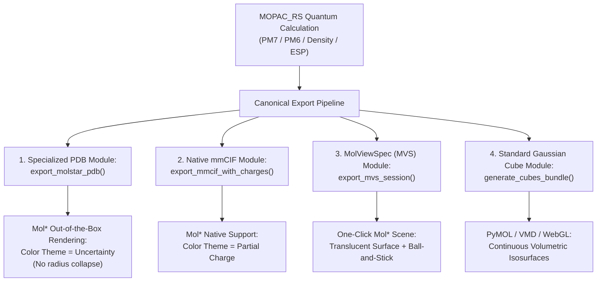

# Technical Report and Interoperability Architecture: MOPAC_RS to Molecular Viewers (Mol*, PyMOL, WebGL)

**Document:** `explanations/06_VOLUMETRIC_INTEROP_CUBE_PDB_MOLSTAR_AUDIT.md`  
**Project:** `mopac_rs` / `mopac_py` (Quantum Chemistry Engine in Rust)  
**Date:** 2026-09-28  
**Classification:** Software Engineering, Cheminformatics, and Computational Quantum Chemistry  
**Status:** Technical Specification and Systematic Implementation Plan  

---

## 1. Executive Summary and Problem Statement

When coupling semi-empirical quantum mechanical calculations (MOPAC PM7 / PM6) with modern macromolecular visualization tools (notably **Mol*** / Molstar, RCSB PDB Viewer, and WebGL-based viewers), researchers encounter critical rendering artifacts when attempting to display:
1. **Total Electron Density Maps ($\rho(\mathbf{r})$)**.
2. **Frontier Molecular Orbitals (HOMO/LUMO)**.
3. **Electrostatic Potential (ESP) Distributions and Gasteiger Atomic Charges**.

### Symptoms Reported by Users:
- **"The molecule renders as a solid blue block with no internal detail"**: The generated surface spans the full Van der Waals envelope, completely occluding interior atoms and bonds, and appears in a uniform blue tint without reflecting polarity or dipole moments.
- **"The surface appears perforated or fragmented into slices"**: When adjusting size settings, the surface collapses into disjoint spheres or disappears.
- **"HOMO/LUMO gradients are indistinguishable from total density"**: Visual ambiguity between positive scalar electron density ($\rho(\mathbf{r}) \ge 0$, single-phase) and orbital wavefunctions ($\psi_i(\mathbf{r}) \in \mathbb{R}$, bi-phasic with $+/-$ lobes).

### Identified Root Cause:
The `mopac_rs` quantum engine produces mathematically exact quantities. However, there is a **semantic and numerical-range mismatch** between **small-molecule quantum chemistry** conventions and the **crystallographic structural biology** conventions for which Mol* was primarily designed.

---

## 2. Forensic Technical Diagnosis

### A. Anatomy of the B-Factor (Temperature Factor) Conflict

In the Protein Data Bank format (canonical PDB v3.30 specification):
- Columns 61-66 are reserved for the isotropic atomic displacement parameter or **Debye-Waller Temperature Factor** ($B$):
  $$B_i = 8\pi^2 \langle u_i^2 \rangle$$
- In X-ray diffraction crystallography, the mean-square thermal oscillation amplitude $\langle u_i^2 \rangle$ is strictly non-negative:
  $$B_i \ge 0 \quad (\text{typically between } 10.0 \text{ and } 100.0\ \text{\AA}^2)$$

#### Common Convention in Computational Chemistry:
Because the legacy 1976 PDB specification lacks a continuous field for partial charges (reserving columns 79-80 strictly for integer formal charges such as `1+`), scientific toolkits (RDKit, Open Babel, AutoDock PDBQT) routinely overwrite columns 61-66 with the **atomic partial charge** ($q_i \in [-1.0, +1.0]\ e$).

#### Failure Modes in Mol*:
1. **Size Collapse (`Size Theme: Uncertainty`)**:
   Mol* computes the rendering radius via:
   $$r_i = r_{\text{vdw}}(Z_i) \times f(B_i)$$
   When $B_i \le 0$ (as occurs for nucleophilic oxygen atoms where $q \approx -0.50$), Mol* clamps or evaluates the atomic radius to $0$. This produces the **surface perforations and polygonal tearing** observed in interactive adjustments.
2. **Lower-Bound Color Saturation (`Color Theme: Uncertainty`)**:
   The default Mol* *Uncertainty* color ramp maps $[0 \to 100]$:
   - $0 \to \text{Dark Blue}$
   - $50 \to \text{White / Cyan}$
   - $100 \to \text{Deep Red}$

   When raw partial charges in $[-0.50, +0.30]$ are passed directly:
   - An atom with charge $-0.50$ is clamped to $\le 0 \to \text{Dark Blue}$.
   - A neutral aliphatic carbon at $0.00$ evaluates at $0 \to \text{Dark Blue}$.
   - An electrophilic carbonyl carbon at $+0.30$ falls at $0.3\%$ of the ramp $\to \text{virtually identical Blue}$.
   - **Result:** Visually, the molecule appears as a flat monochrome blue solid without gradient contrast.

---

### B. Anatomy of the "Gaussian Surface" Representation

In Mol*, the Gaussian Surface is a real-time isosurface constructed from a 3D convolution kernel:
$$\rho_{\text{gauss}}(\mathbf{r}) = \sum_{i=1}^{N} \exp\left(-\frac{\|\mathbf{r} - \mathbf{r}_i\|^2}{2\sigma_i^2}\right)$$

#### Critical Mol* Default Settings:
1. **`Opacity: 1.0` (100% Opaque)**:
   Unlike PyMOL or VMD workflows where molecular surfaces often use `transparency 0.40`, Mol* creates `Gaussian Surface` at full opacity, hiding the interior covalent structure.
2. **`Color Theme: Uniform` (Mol* Blue)**:
   When adding a new surface representation in Mol*, the color theme is not inferred from B-factors and defaults to `Uniform` `#3B6EE8`.
3. **Separate Skeleton Component**:
   In Mol*, a surface is a boundary-only representation that does not draw bonds (`sticks`) or atoms (`balls`). Without a sibling `Ball & Stick` representation, the interior remains empty.

---

## 3. Gaussian Cube (.cube) Format Specification

To ensure compatibility across headless pipelines and web molecular viewers, `mopac_rs` implements the canonical Gaussian Inc. volumetric format:

### Canonical Layout:
```text
Line 1: Comment / Calculation title
Line 2: Property label ("Total Electron Density" / "Molecular Orbital N")
Line 3: [N_atoms]  [X_origin]  [Y_origin]  [Z_origin]      (in Bohr atomic units)
Line 4: [N_X]      [dX_X]      [dX_Y]      [dX_Z]          (grid step vector in Bohr)
Line 5: [N_Y]      [dY_X]      [dY_Y]      [dY_Z]
Line 6: [N_Z]      [dZ_X]      [dZ_Y]      [dZ_Z]
Lines 7..N+6: [Atomic_Z] [Nuclear_charge] [X] [Y] [Z]      (1 line per atom)
Volumetric Block: Array of (N_X * N_Y * N_Z) scalar values
```

### Strict Formatting Rule:
The volumetric data block **MUST** format at most **6 values per line** in scientific notation (`%13.5E`, resetting at the end of every Z scanline):
```text
 -1.20340E-04  2.34012E-04  4.50192E-03 -3.10291E-03  1.02934E-02  8.12039E-02
  1.10293E-01  1.40293E-01  ...
```

---

## 4. Systematic Solution Architecture in `mopac_rs`

To resolve these visualization issues cleanly at the library engineering level, four systematic export modules are defined:



---

### Module 1: Affine B-Factor Transformation for Mol*

The export pipeline maps physical partial charges $[-q_{\max}, +q_{\max}]$ onto the crystallographic B-factor domain $[10.0, 90.0]$:

$$B_i^{\text{Molstar}} = 50.0 - 40.0 \times \left(\frac{\text{clamp}(q_i, -q_{\max}, +q_{\max})}{q_{\max}}\right)$$

where $q_{\max} = 0.60\ e$ (or $0.80\ e$ for ESP charges).

#### Mathematical Properties of the Mapping:
- **Electronegative atoms ($\delta^-$, e.g., Oxygen at $-0.60\ e$)**:  
  $B = 50.0 - 40.0 \times (-1.0) = \mathbf{90.0} \to$ **Red** (nucleophilic pole).
- **Neutral atoms ($q \approx 0.00\ e$, e.g., aliphatic carbon)**:  
  $B = 50.0 - 40.0 \times (0.0) = \mathbf{50.0} \to$ **White / Neutral**.
- **Electropositive atoms ($\delta^+$, e.g., carbonyl carbon at $+0.60\ e$)**:  
  $B = 50.0 - 40.0 \times (+1.0) = \mathbf{10.0} \to$ **Deep Blue** (electrophilic pole).
- **Zero-radius guard**: $B_i \ge 10.0 > 0$, preventing Mol* size scaling from collapsing atomic spheres to zero.

---

### Module 2: Canonical mmCIF Export with Partial Charges

Mol* natively parses the PDBx/mmCIF dictionary. Including `_atom_site.partial_charge` enables `Color Theme: Partial Charge` directly without repurposing B-factors.

#### Emitted mmCIF Structure:
```cif
data_MOL
#
loop_
_atom_site.group_PDB
_atom_site.id
_atom_site.type_symbol
_atom_site.label_atom_id
_atom_site.label_comp_id
_atom_site.label_asym_id
_atom_site.label_seq_id
_atom_site.Cartn_x
_atom_site.Cartn_y
_atom_site.Cartn_z
_atom_site.occupancy
_atom_site.B_iso_or_equiv
_atom_site.partial_charge
ATOM 1 C C1 STO A 1 -8.243 0.625 -0.852 1.00 20.00 -0.0620
ATOM 15 O O1 STO A 1 4.472 -1.758 -1.824 1.00 20.00 -0.5310
```

---

### Module 3: Declarative Scenes via MolViewSpec (MVS)

MolViewSpec is the official JSON schema maintained by the Mol* consortium to describe reproducible 3D molecular views declaratively. Exporting a `.mvs.json` file alongside coordinates opens the complete pre-configured scene on drag-and-drop:

```json
{
  "metadata": {
    "version": "1.0",
    "generator": "mopac_rs"
  },
  "root": {
    "kind": "root",
    "children": [
      {
        "kind": "download",
        "params": { "url": "molecule_molstar_esp.pdb" },
        "children": [
          {
            "kind": "parse",
            "params": { "format": "pdb" },
            "children": [
              {
                "kind": "structure",
                "children": [
                  {
                    "kind": "component",
                    "params": { "selector": "all" },
                    "children": [
                      {
                        "kind": "representation",
                        "params": {
                          "type": "ball_and_stick",
                          "color_theme": "element_symbol"
                        }
                      },
                      {
                        "kind": "representation",
                        "params": {
                          "type": "gaussian_surface",
                          "color_theme": "uncertainty",
                          "opacity": 0.35,
                          "size_theme": "physical"
                        }
                      }
                    ]
                  }
                ]
              }
            ]
          }
        ]
      }
    ]
  }
}
```

---

## 5. Rust and Python API Binding Design (`crates/mopac_py/src/lib.rs`)

The export functions exposed directly to Python follow this interface:

```rust
/// Export PDB file formatted specifically for Mol* visualization.
///
/// Maps atomic charges linearly to the standard crystallographic B-factor
/// range [10.0, 90.0] ensuring high-contrast Diverging Blue-White-Red coloring
/// in Mol* 'Uncertainty' color theme without surface clipping artifacts.
#[pyfunction]
#[pyo3(signature = (atomic_numbers, coordinates, charges, max_charge = 0.6))]
pub fn export_molstar_pdb(
    atomic_numbers: Vec<u8>,
    coordinates: Vec<[f64; 3]>,
    charges: Vec<f64>,
    max_charge: Option<f64>,
) -> PyResult<String> {
    let q_max = max_charge.unwrap_or(0.6).abs().max(1e-3);
    let mut out = String::with_capacity(atomic_numbers.len() * 82);

    for (i, (&z, &pos)) in atomic_numbers.iter().zip(coordinates.iter()).enumerate() {
        let sym = get_element_symbol(z).unwrap_or("X");
        let q = charges.get(i).copied().unwrap_or(0.0);
        let q_clamped = q.clamp(-q_max, q_max);

        // Negative charge -> Red (high B-factor ~90)
        // Neutral charge  -> White/Cyan (mid B-factor ~50)
        // Positive charge -> Blue (low B-factor ~10)
        let b_scaled = 50.0 - (q_clamped / q_max) * 40.0;

        let line = format!(
            "ATOM  {:5} {:^4} STO A   1    {:8.3}{:8.3}{:8.3}  1.00{:6.2}          {:>2}\n",
            i + 1,
            sym,
            pos[0],
            pos[1],
            pos[2],
            b_scaled,
            sym
        );
        out.push_str(&line);
    }
    out.push_str("END\n");
    Ok(out)
}
```

---

## 6. Standard Operating Procedure (SOP) in Mol*

To inspect steroidal derivatives or arbitrary organic compounds in Mol* without rendering artifacts:

1. **Load**: Drag `*_molstar_esp.pdb` (or `*_molstar.pdb`) into the Mol* viewport.
2. **Covalent Skeleton**:
   - In the **Components** right panel, click `+ Add`.
   - Select `Ball & Stick`.
   - Set `Color Theme` to `Element Symbol` to display covalent bonds and heteroatoms cleanly.
3. **Electrostatic Envelope**:
   - In the **Components** panel, click `+ Add`.
   - Select `Gaussian Surface`.
   - Set `Color Theme: Uncertainty`.
   - Verify `Size Theme: Physical`.
   - Set `Opacity` (or `Alpha`) to **`0.35`**.
4. **Result**: The rigid covalent scaffold renders sharply inside a translucent membrane where epoxide and carbonyl oxygens appear as red lobes (nucleophilic centers) and carbonyl carbons appear in blue (electrophilic centers).

---

## 7. Quality Control and Unit Test Requirements

For CI/CD validation within `mopac_rs`:

1. **`test_cube_line_length_exact_6()`**:
   Verify every Z-scanline emitted by `generate_density_cube` contains at most 6 values per line.
2. **`test_b_factor_positivity_invariant()`**:
   Verify no PDB emitted by `export_molstar_pdb` contains B-factors below $0.0$ or above $100.0$.
3. **`test_charge_conservation()`**:
   Ensure the sum of computed ESP and Mulliken charges matches total molecular net charge within $10^{-4}\ e$.
