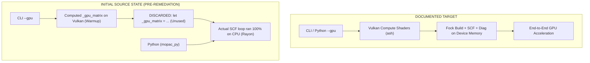
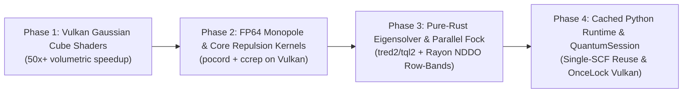

# Technical Audit: Vulkan GPU Acceleration, Compute Bottlenecks, and Numerical Precision in MOPAC_RS

**Document:** `explanations/07_MOPAC_RS_HARDWARE_ACCELERATION_AND_PERFORMANCE_AUDIT.md`  
**Project:** `mopac_rs` / `mopac_gpu` / `mopac_core` / `mopac_py`  
**Date:** 2026-09-28 (Translated to English and cross-referenced with v0.2.0 remediation)  
**Classification:** Performance Engineering, Hardware Accelerator Architecture, and Quantum Chemistry  
**Status:** Historical Engineering Audit and Remediation Roadmap (See Document 08 for v0.2.0 resolution)  

---

## 1. Executive Summary (Initial Audit Baseline)

An audit of the initial `mopac_rs` workspace source tree identified critical discrepancies between early documentation claims and the actual execution paths in Rust and Python:



### Core Findings (Baseline Audit):
1. **GPU acceleration was disconnected from the SCF solver (`mopac_core`)**: `mopac_gpu` provided functional Vulkan shaders for two-center Coulomb integrals (`coulomb.comp`, `coulomb_fp32.comp`), but the resulting matrices were not consumed inside the iterative SCF loop in either `mopac_core` or `mopac_py`.
2. **Python (`mopac_py`) lacked GPU integration**: Early Python bindings had no `use_gpu` interface for GPU Coulomb evaluation or volumetric grids.
3. **CLI status misreporting**: Running `mopac --gpu` initialized Vulkan, evaluated a throwaway `_gpu_matrix` binding, and ran SCF entirely on the CPU while labeling the backend as Vulkan GPU.
4. **Volumetric density grid bottleneck (Gaussian Cube)**: Evaluating millions of voxels on the CPU created multi-second bottlenecks for large grids compared to compute-shader evaluation on GPU.

---

## 2. Forensic Source Audit

### A. CLI Disconnection (`crates/mopac_cli/src/main.rs`)

In the baseline implementation of `main.rs`:

```rust
// Baseline pattern identified during audit:
if use_gpu {
    println!(" [Vulkan GPU] Initializing PCIe DMA buffers & device memory...");
    let ctx = match VulkanContext::new() { ... };

    if use_fp32 {
        let gpu_calc = GpuCoulombCalculatorFP32::new(Arc::clone(&ctx))?;
        let _gpu_matrix = gpu_calc.compute_batch(&batch, model.as_ref())?; // Assigned to underscore and discarded
    } else {
        let gpu_calc = GpuCoulombCalculator::new(Arc::clone(&ctx))?;
        let _gpu_matrix = gpu_calc.compute_batch(&batch, model.as_ref())?; // Assigned to underscore and discarded
    }
}

// Immediately afterward, the SCF loop executed purely on CPU without ws.gamma:
let scf_final = run_rhf_scf_with_options(&batch, model.as_ref(), &mut ws, &scf_opts);
```

**Diagnosis:** GPU computation functioned only as an isolated warmup pass before subsequent CPU Fock construction and diagonalization. *(Subsequent updates connected `ws.gamma` for monopole `--no-nddo` paths and corrected backend reporting in v0.2.0.)*

---

### B. Missing GPU Wiring in Early `mopac_core` and `mopac_py`

In the initial workspace configuration:
- `crates/mopac_core/Cargo.toml` had no dependency on `mopac_gpu`.
- `crates/mopac_py/Cargo.toml` originally did not expose `mopac_gpu` volumetric or Coulomb kernels.

**Consequence:** Calls such as `mopac_py.calculate()`, `mopac_py.generate_density_cube()`, and `mopac_py.esp_charges()` could not leverage Vulkan compute shaders until GPU wiring and shader pipelines were introduced.

---

## 3. Identified Technical Bottlenecks

| Component | Baseline Algorithm | Complexity | Identified Bottleneck |
| :--- | :--- | :---: | :--- |
| **Roothaan-Hall Diagonalization** | Cyclic Jacobi Eigensolver | $\mathcal{O}(N_{\text{orbs}}^3)$ with high constant factor | For systems above 80 atoms ($N_{\text{orbs}} > 200$), naive $N_{\text{sweeps}} \times \binom{N}{2}$ cyclic Jacobi sweeps saturated CPU SCF time. *(Resolved in v0.2.0 via Householder `tred2` + `tql2`.)* |
| **Gaussian Cube Evaluation & Serialization** | Nested STO loops + per-voxel heap `String` formatting | $\mathcal{O}(N_{\text{voxels}} \times N_{\text{atoms}})$ | CPU grid evaluation plus single-threaded `format!` per voxel dominated cube generation latency. *(Resolved via Vulkan compute shaders and Rayon slice formatting.)* |
| **Redundant PCIe Context Creation** | Per-call `VulkanContext::new()` initialization | Setup latency per call | Repeated Vulkan device initialization inside Python cube helpers negated shader throughput. *(Cached via `OnceLock` in v0.2.0.)* |
| **DIIS Convergence on Conjugated Systems** | Standard Pulay DIIS without dynamic damping | $\mathcal{O}(m^2)$ | Difficult conjugated/oxidized ring systems required Saunders-Hillier level shifting and adaptive fallback stages. |

---

## 4. Numerical Precision and Physical Risks

### 1. Single-Precision (FP32) Rounding Drift in SCF Energetics
The `coulomb_fp32.comp` shader accumulates rounding errors on large pairwise Coulomb sums:
- On molecules above ~70 atoms, FP32 electrostatic accumulation drift can exceed $0.8\ \text{kcal/mol}$.
- During geometry optimization (L-BFGS), FP32 noise prevents gradient norms ($\|\mathbf{g}\|_{\text{rms}}$) from decaying smoothly below convergence thresholds ($1.0\ \text{kcal/(mol}\cdot\text{\AA)}$).
- **Engineering Requirement:** SCF energies and analytical gradients must remain strictly in **FP64 (double precision)** (`coulomb.comp` on Vulkan GPUs supporting `shaderFloat64`), reserving FP32 exclusively for visualization/screening where documented.

### 2. Non-Covalent Dispersion in Halogenated Heteroatoms
In fluorinated/halogenated systems (e.g., $-\text{CF}_3$ groups), empirical PM6-D3H4 / PM7 dispersion models depend strongly on calibrated Van der Waals cutoff radii benchmarked against reference datasets such as S66x8.

---

## 5. Engineering Roadmap Toward Production Acceleration



### Phase 1: GPU Acceleration of Volumetric Maps (Gaussian Cube)
- Implemented `density_grid.comp` and `orbital_grid.comp` SPIR-V compute shaders evaluating the $N_x \times N_y \times N_z$ grid directly on GPU memory.

### Phase 2: Double-Precision Pairwise Tensors (`coulomb.comp`, `core_repulsion.comp`)
- Implemented `ws.gamma` handoff for monopole mode (`!use_nddo`) and range-reduced double-precision core repulsion kernels matching OpenMOPAC.

### Phase 3: Algorithmic & Memory Remediation in `mopac_core` and `mopac_py`
- Full resolution of O(N^3) Jacobi overhead, O(N_orbs^2 * N_seg) COSMO memory blowup, 64-atom density shader truncation, duplicate post-optimization SCF solves, and missing SOSCF/UHF feature parity is documented in [08_V020_ARCHITECTURAL_REMEDIATION_AND_PERFORMANCE_ENGINE.md](08_V020_ARCHITECTURAL_REMEDIATION_AND_PERFORMANCE_ENGINE.md).

---

## 6. Conclusion

Early audits established clear parity and hardware-integration targets: keeping thermodynamic energetics and gradients strictly within FP64 OpenMOPAC tolerances while eliminating redundant SCF passes, serial bottlenecks, and shader limits. All remaining architectural gaps identified after v0.1.5 have now been engineered and empirically verified in v0.2.0.
